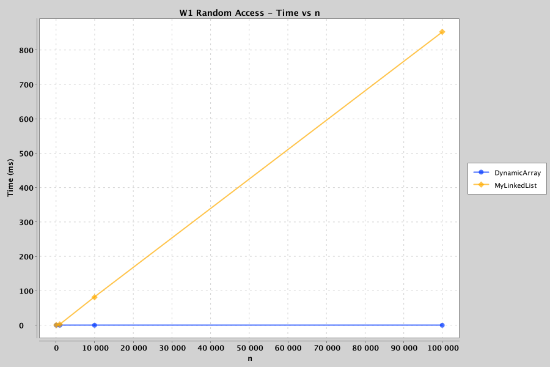
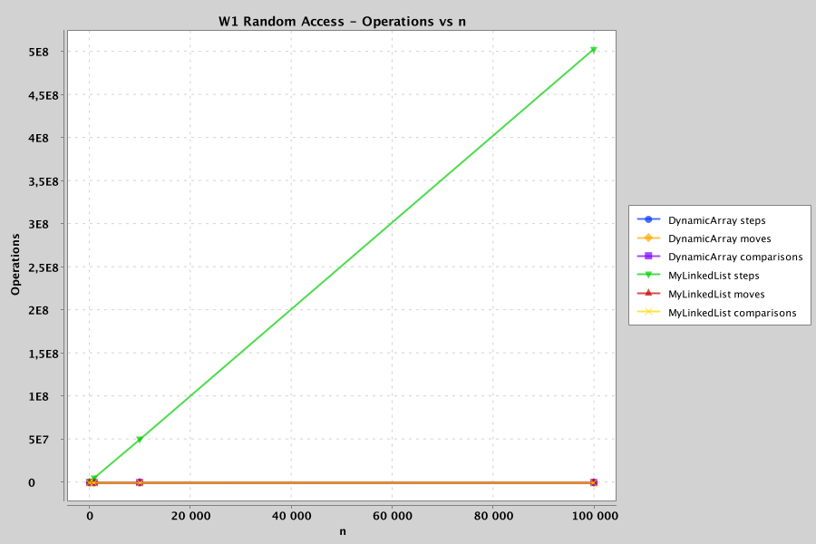
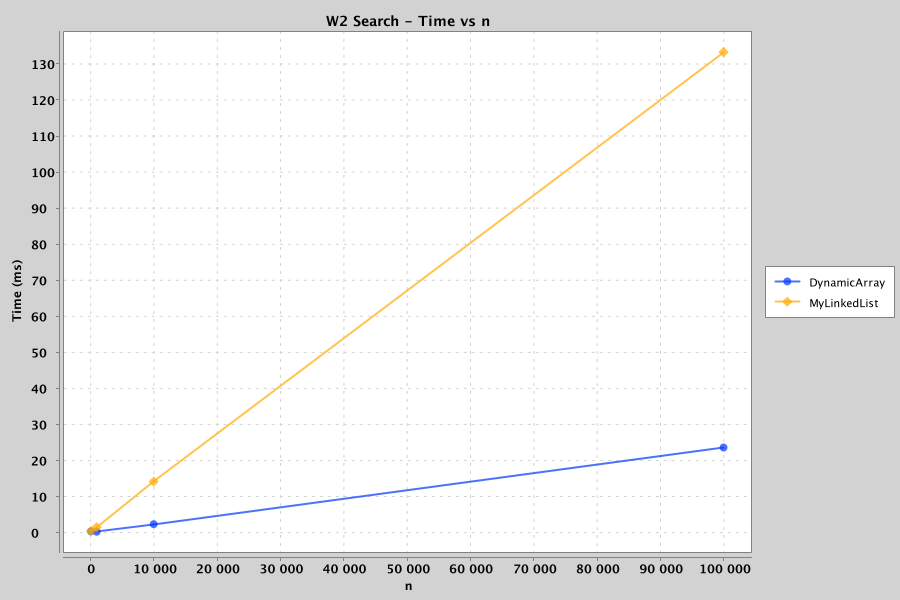
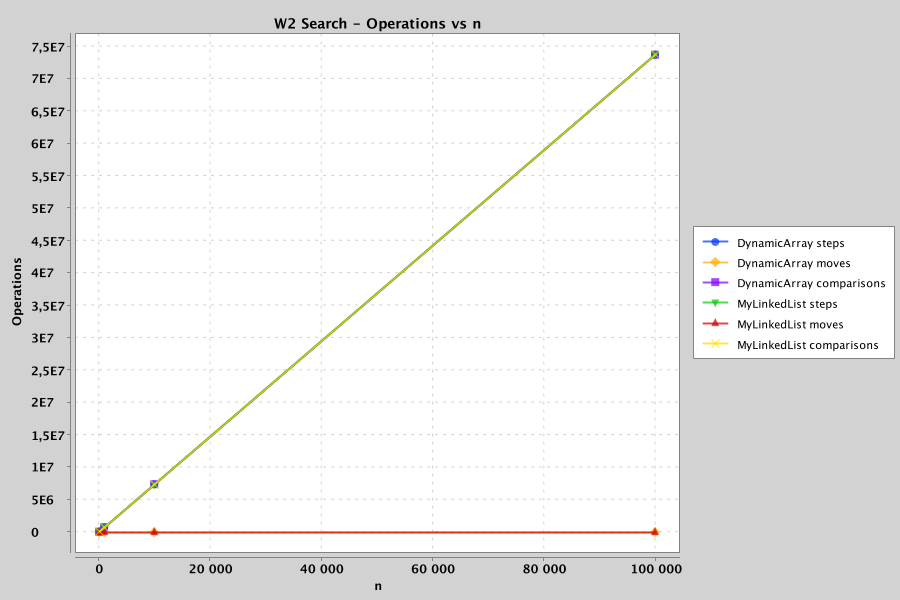
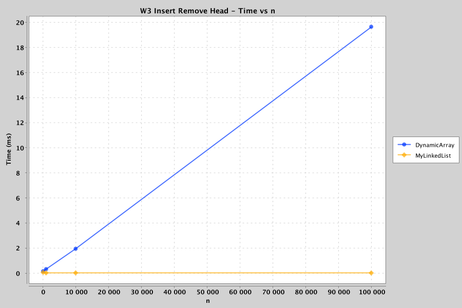
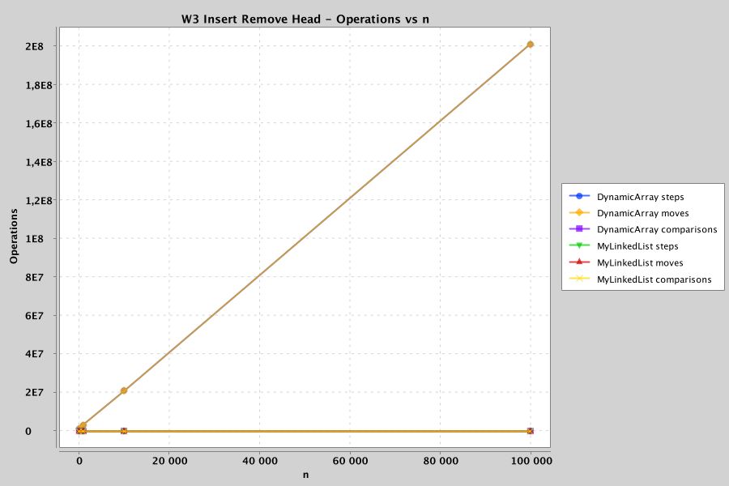
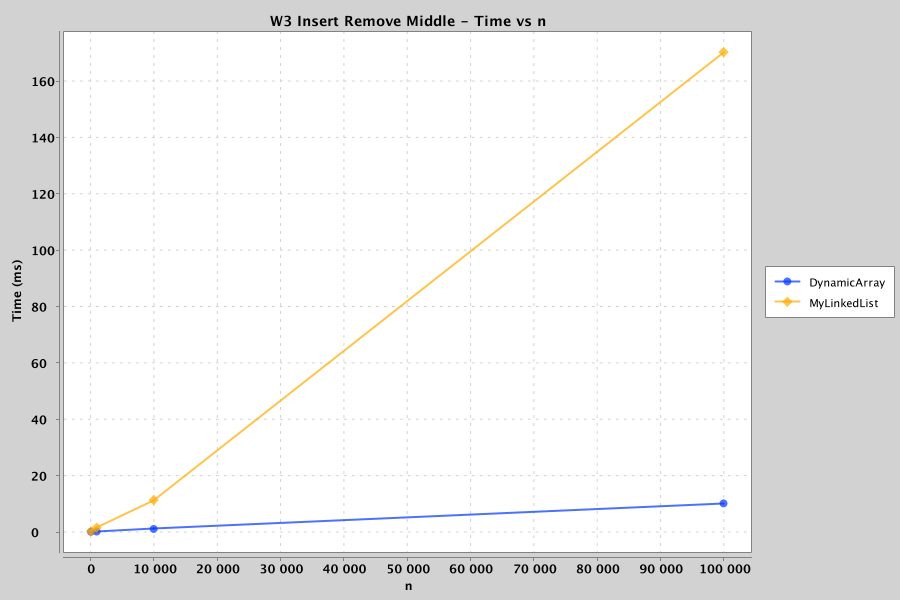
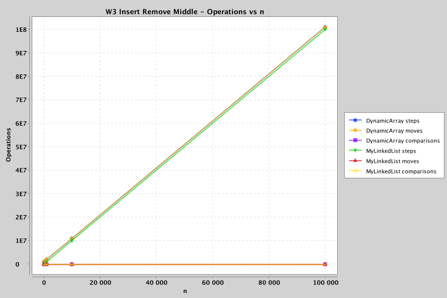
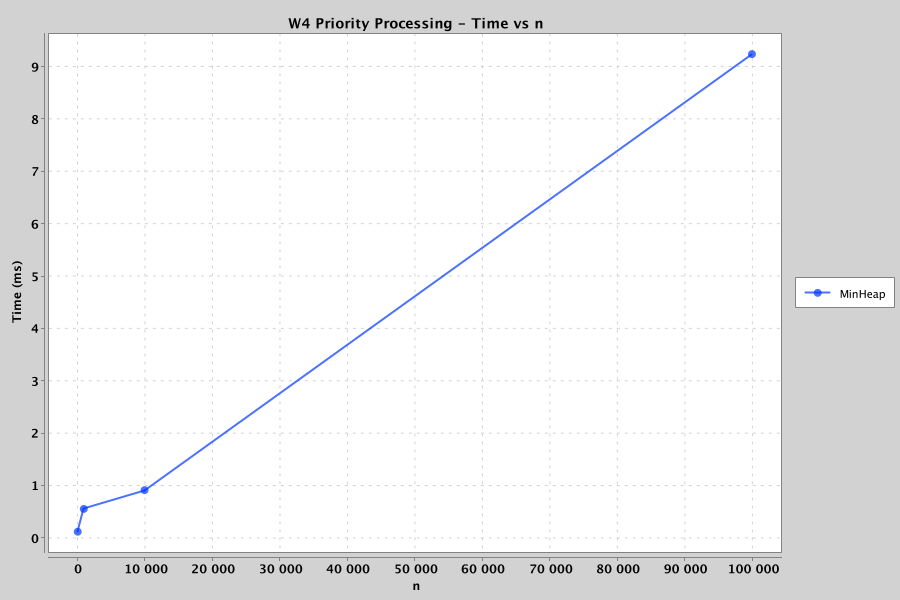
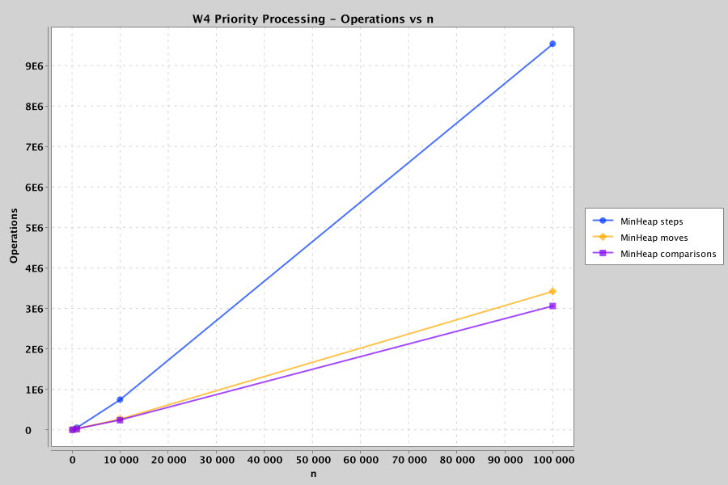

# DAA Assignment 2 - Data Structures Report

**Student:** Zhakanov Sanzhar  
**Group:** SE-2526

## 1. Overview

This assignment implements three data structures from scratch: DynamicArray, MyLinkedList, and MinHeap.

DynamicArray and MinHeap use primitive `int[]` storage. MyLinkedList uses nodes containing primitive `int` values. Standard Java collection classes are not used inside the implementations.

The benchmark evaluates the structures using four workloads:

- W1 - Random Access
- W2 - Search
- W3 - Insert and Remove
- W4 - Priority Processing

The tested input sizes are 100, 1,000, 10,000, and 100,000. The same deterministic data is generated using `new Random(42)`.

Each benchmark case uses warm-up runs followed by five measured runs, and the median execution time is stored in `results/results.csv`.

---

## 2. Complexity Analysis

### DynamicArray

| Operation | Best Case | Average Case | Worst Case | Auxiliary Space | Justification |
|---|---|---|---|---|---|
| `add(x)` | Θ(1) | Θ(1) amortized | Θ(n) | Θ(n) during resize | Normally inserts at the end in constant time. When the array is full, all elements are copied into an array with twice the capacity. |
| `add(index, x)` | Θ(1) | Θ(n) | Θ(n) | Θ(n) during resize | Insertion near the end may require little or no shifting, while insertion near the beginning shifts many elements. |
| `remove(index)` | Θ(1) | Θ(n) | Θ(n) | Θ(1) | Removing the last element requires no shift. Other positions may require shifting the remaining elements left. |
| `get(index)` | Θ(1) | Θ(1) | Θ(1) | Θ(1) | Array indexing provides direct access to an element. |
| `contains(x)` | Θ(1) | Θ(n) | Θ(n) | Θ(1) | The first element may match immediately, while an absent value requires checking all elements. |

DynamicArray has good spatial locality because its elements are stored next to each other in memory.

### MyLinkedList

| Operation | Best Case | Average Case | Worst Case | Auxiliary Space | Justification |
|---|---|---|---|---|---|
| `add(x)` | Θ(1) | Θ(n) | Θ(n) | Θ(1) | The empty-list case is constant, but without a tail pointer the implementation must normally traverse to the last node. |
| `add(index, x)` | Θ(1) | Θ(n) | Θ(n) | Θ(1) | Insertion at the head is constant time, while other positions require traversal to the preceding node. |
| `remove(index)` | Θ(1) | Θ(n) | Θ(n) | Θ(1) | Removing the head is constant time. Removing later elements requires traversal. |
| `get(index)` | Θ(1) | Θ(n) | Θ(n) | Θ(1) | Accessing the first node is constant time, while accessing later nodes requires following links. |
| `contains(x)` | Θ(1) | Θ(n) | Θ(n) | Θ(1) | The value may be found immediately or the entire list may need to be traversed. |

MyLinkedList does not provide direct indexed access. Every movement through the list follows a node reference.

### MinHeap

| Operation | Best Case | Average Case | Worst Case | Auxiliary Space | Justification |
|---|---|---|---|---|---|
| `insert(x)` | Θ(1) | O(log n) | Θ(log n) | Θ(n) during resize | The new value may already satisfy the heap property, or it may bubble up from the bottom to the root. |
| `peekMin()` | Θ(1) | Θ(1) | Θ(1) | Θ(1) | The minimum element is always stored at index 0. |
| `extractMin()` | Θ(1) | O(log n) | Θ(log n) | Θ(1) | After replacing the root with the last element, the value may remain at the root or bubble down through the heap height. |

A binary heap has height Θ(log n), which limits the number of levels visited by bubble-up and bubble-down.

---

## 3. Loop Invariant Proof 1 - DynamicArray `contains(x)`

### Invariant

Before each iteration with index `i`, none of the elements in positions `0` through `i - 1` is equal to `x`.

### Initialization

Before the first iteration, `i = 0`. There are no previously examined elements, so the invariant is true.

### Maintenance

During an iteration, `data[i]` is compared with `x`.

If `data[i] == x`, the method returns `true` and the search is complete.

If `data[i] != x`, then every element from index `0` through `i` is known to be different from `x`. Therefore, before the next iteration, the invariant remains true.

### Termination

The loop terminates either because the value is found or because `i == size`.

If the loop reaches `i == size`, all valid elements have been examined and none is equal to `x`. Therefore, returning `false` is correct.

### Conclusion

The invariant proves that `contains(x)` never skips an element. It returns `true` exactly when the value exists in the DynamicArray and returns `false` otherwise.

---

## 4. Loop Invariant Proof 2 - MinHeap `extractMin()` Bubble-Down

### Invariant

Before every iteration of the bubble-down loop, the heap property is valid everywhere except possibly between the element at the current `index` and its children.

### Initialization

Before bubble-down starts, the minimum element has been removed and the last heap element has been moved to index 0.

The two subtrees below the root were valid heaps before the removal and remain unchanged. Therefore, only the new root may violate the heap property.

### Maintenance

During each iteration, the current element is compared with its left and right children.

If the current element is already the smallest, the heap property is restored and the loop stops.

Otherwise, it is swapped with its smallest child. After the swap, the parent position satisfies the heap property. Any possible violation has moved downward to the new current index.

Therefore, the invariant remains true before the next iteration.

### Termination

The loop stops when the current element has no smaller child or when it reaches a position where the heap property is satisfied.

At this point there is no remaining violation, so every parent is less than or equal to its children.

### Conclusion

The loop invariant proves that bubble-down correctly restores the min-heap property after `extractMin()`.

---

## 5. Benchmark Results

### W1 - Random Access

DynamicArray provides direct indexed access and therefore requires one array access for each `get(index)` operation.

MyLinkedList must follow node references until it reaches the requested index. As `n` increases, the difference between the two structures becomes much larger.

### W2 - Search

Both structures use linear search for `contains(x)`, so both have Θ(n) worst-case complexity.

However, equal asymptotic complexity does not guarantee equal execution time. DynamicArray accesses consecutive memory locations, while MyLinkedList follows references between separate node objects.

### W3 - Insert and Remove at Head

Insertion and removal at index 0 require DynamicArray to shift many elements.

For MyLinkedList, operations at the head only require changing a small number of references. This is a workload where the linked list has an important structural advantage.

### W3 - Insert and Remove at Middle

Middle operations are expensive for both structures for different reasons.

DynamicArray must shift elements, while MyLinkedList must traverse nodes to reach the required position before changing links.

### W4 - Priority Processing

MinHeap provides efficient priority processing.

The minimum element is available at the root in Θ(1) time using `peekMin()`. Insertions and extractions use the logarithmic-height heap structure to restore the heap property.

The benchmark also verifies that repeated calls to `extractMin()` produce values in non-decreasing order.

---

## 6. Discussion

DynamicArray is especially efficient for indexed access because an array can calculate the memory location of an element directly from its index. Its elements are stored contiguously, which gives good spatial locality and allows the CPU cache to load nearby values efficiently. This is why array traversal can be fast even when another structure has the same asymptotic complexity. MyLinkedList stores each value inside a separate node object, so consecutive logical elements are not guaranteed to be located next to each other in memory. Traversing the list therefore requires pointer chasing, where the address of the next node must be read before the processor knows where to continue. This reduces the effectiveness of CPU cache lines and can increase memory latency. Node objects also require additional memory for object headers and references. Creating many node objects can increase allocation pressure and eventually add work for the garbage collector. DynamicArray avoids most of this per-element object overhead because it stores primitive integers directly inside one array. However, DynamicArray performs many moves when inserting or removing elements near the beginning or middle. MyLinkedList is a better choice when modifications happen at the head because changing links does not require shifting all later values. In this implementation, random indexed operations on MyLinkedList remain expensive because reaching a position requires traversal from the head. MinHeap is the better choice when data must be processed according to minimum priority rather than insertion order or index. It provides constant-time access to the minimum and logarithmic insertion and extraction. The benchmark demonstrates that Big-O notation is essential for describing growth, but memory layout, cache locality, pointer traversal, and constant factors also strongly affect real execution time.

---

## 7. Conclusion

The three data structures are designed for different workloads.

DynamicArray is the strongest choice for random indexed access and cache-friendly traversal. MyLinkedList is useful for operations that can modify links without shifting array elements, especially at the head. MinHeap is appropriate for priority-based processing where the smallest value must be accessed and removed efficiently.

The measured operation counters and execution times demonstrate both the theoretical complexity differences and the practical performance effects of memory organization.